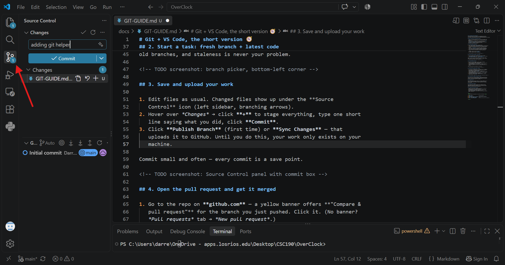
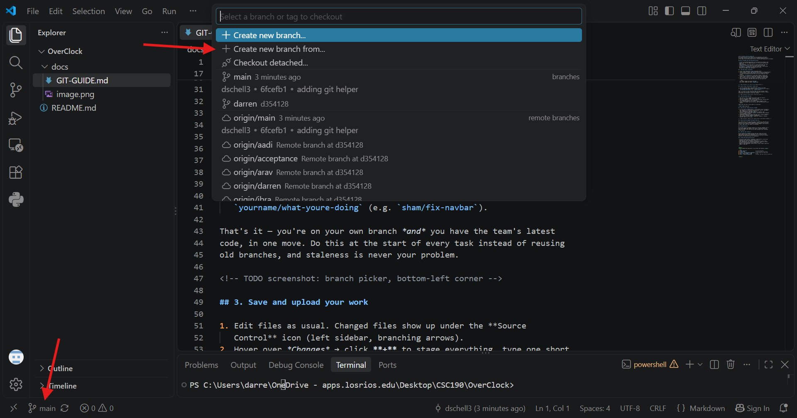

# Git + VS Code, the short version 🧭
Our standard workflow is **VS Code on your own machine**; the browser
covers quick one-file edits (section 5). If something happens that isn't
on this page, stop and ping Jang or Darren in Discord and nothing here is unfixable.

<details>
<summary>Command-line equivalents (if you prefer the terminal)</summary>

```bash
git clone <repo-url>                     # one-time download
git fetch origin                         # grab the latest from GitHub
git switch -c yourname/task origin/main  # fresh branch off latest main
git add -A && git commit -m "msg"        # save
git push -u origin yourname/task         # upload, then open the PR on github.com
```

</details>

## How our branches work (the 30-second version)

- **`main`**: the shared team branch. Your work gets here through a pull
  request (PR) that one teammate approves. It's the only branch you ever
  merge into.
- **Your branches**: start each task on a fresh branch made from `main`
  (section 2) — think of a branch as a private copy of the code.
- **`acceptance` / `production`**: what the client sees / the live app.
  Only Jang can change these — GitHub physically blocks
  everyone else. Ignore that they exist.

## 1. One-time setup (~10 minutes)

1. Install **[VS Code](https://code.visualstudio.com)**.
2. Install **Git**: Windows — [git-scm.com](https://git-scm.com/download/win),
   run the installer, accept every default. Mac — VS Code will prompt you
   to install the command line tools the first time it needs Git; click
   Install.
3. In VS Code: `Ctrl/Cmd+Shift+P` → type **Git: Clone** → *Clone from
   GitHub* → sign in when your browser pops up → pick the **OverClock**
   repo → choose a folder (e.g. Documents) → **Open** the cloned folder.
4. Tell Git who you are (one time only): open VS Code's terminal with
   **Ctrl+`** (backtick) and paste these two lines, with your info:

   ```bash
   git config --global user.name "Your Name"
   git config --global user.email "you@csus.edu"
   ```

<!-- TODO screenshot: Git: Clone in the command palette -->

## 2. Start a task: fresh branch + latest code

1. Click the **branch name in the bottom-left corner** of VS Code.
2. Pick **"Create new branch from…"** → choose **`origin/main`** → name it
   `yourname/what-youre-doing` (e.g. `sham/fix-navbar`).

That's it — you're on your own branch *and* you have the team's latest
code, in one move. Do this at the start of every task instead of reusing
old branches, and staleness is never your problem.



## 3. Save and upload your work

1. Edit files as usual. Changed files show up under the **Source
   Control** icon (left sidebar, branching arrows).
2. Hover over *Changes* → click **+** to stage everything, type one short
   line saying what you did, click **Commit**.
3. Click **Publish Branch** (first time) or **Sync Changes** — that
   uploads it to GitHub. Until you do this, your work only exists on your
   machine.

Commit small and often — every commit is a save point.

=

## 4. Open the pull request and get it merged

1. Go to the repo on **github.com** — a yellow banner offers **"Compare &
   pull request"** for the branch you just pushed. Click it. (No banner?
   *Pull requests* tab → *New pull request*.)
2. Check the dropdowns read **base: `main`** ← **compare: (your
   branch)**, click **Create pull request**, and drop the link in Discord
   for any teammate to review.
3. **Reviewing someone else's PR:** open their link → **Files changed** →
   look it over → **Review changes** → **Approve**.
4. Once approved with green checks: **Merge pull request** → **Delete
   branch**. Done — it's in `main`.

<!-- TODO screenshot: compare & pull request banner; base/compare dropdowns -->

## 5. Quick one-file change? The browser works too

For a typo-sized fix you can skip VS Code: on github.com, open the file →
**pencil ✏️** → edit → **Commit changes…** → keep **"Create a new branch
and start a pull request"** selected → *Propose changes* → then section 4
as usual. Same rules, just faster for tiny edits.

## 6. Running the site

TODO: when repo is standing

## 7. When Git says "conflict"

You and someone else changed the same lines and a human has to pick.
**Don't guess and don't force anything** — post in Discord with your
branch/PR link, and Jang or Darren will sort it out ASAP.
Conflicts are normal and boring, not emergencies.

## 8. Things that look scary but aren't

- **"You can't push to main / acceptance / production"** → correct and
  expected; work on your own branch (section 2).
- **VS Code asks about "periodically run git fetch"** → yes is fine.
- **You committed on `main` locally by accident** → GitHub will refuse
  the push; ping Darren/Jang — your changes aren't lost.
- **Want to undo something** → Source Control ⋯ menu → Commit → Undo Last
  Commit, or just ask.

---

