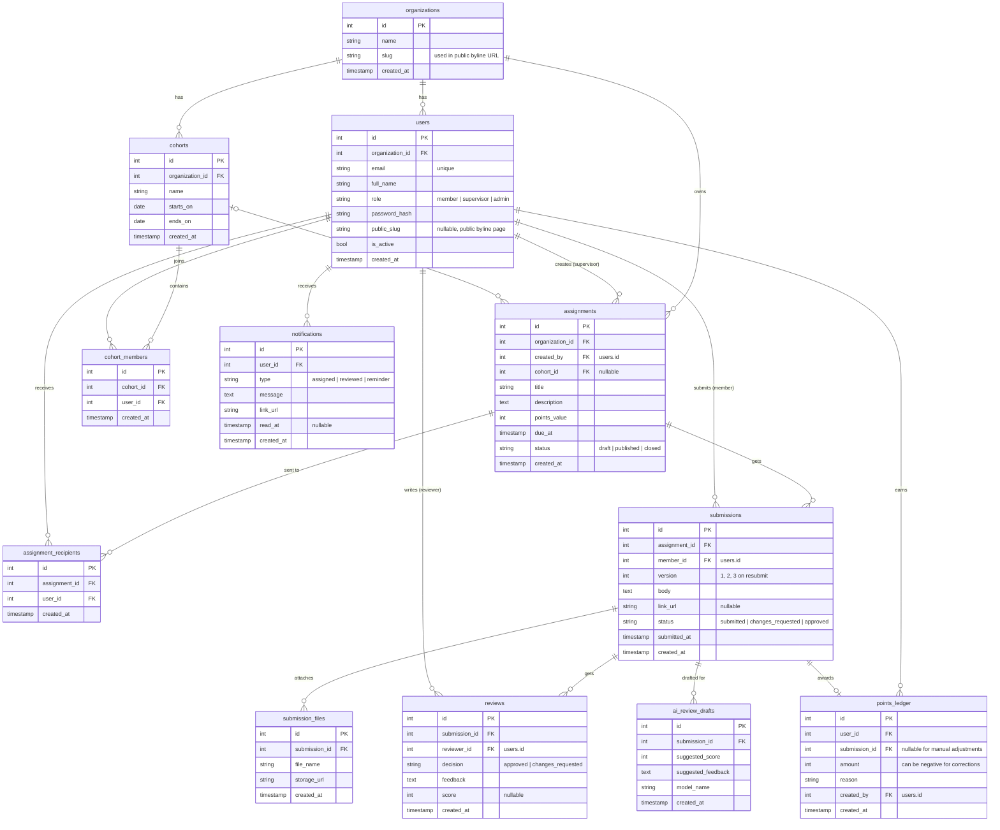

# Byline ERD and table list (SCRUM-67)

Draft for the team review. Database: Postgres (SQLAlchemy models in `api/`, built by SCRUM-68).
Every table has `id` (primary key) and `created_at`. Arrows below read "one to many".

## The 12 tables

| # | Table | What it stores |
|---|---|---|
| 1 | organizations | The client company (The Emerson Empire). Lets us support more orgs later. |
| 2 | users | Everyone who signs in. `role` is member, supervisor or admin. |
| 3 | cohorts | A group of interns, e.g. "Fall 2026 interns". |
| 4 | cohort_members | Which users are in which cohort. |
| 5 | assignments | Work a supervisor posts: title, instructions, due date, points. |
| 6 | assignment_recipients | Which members an assignment was sent to. |
| 7 | submissions | A member's hand-in. A resubmit is a new row with `version + 1`. |
| 8 | submission_files | Files attached to a submission. |
| 9 | reviews | Reviewer decision (approve or request changes) plus feedback. |
| 10 | ai_review_drafts | CSC 191 AI assistant's suggested score and feedback. Never approves or awards points. |
| 11 | points_ledger | Append-only: rows are only added, never edited or deleted (SCRUM-69). A member's total is `SUM(amount)`. |
| 12 | notifications | In-app alerts and the source for email reminders. |

**No table needed for:** the approved-work page (it's `submissions` where status = approved) or points totals (it's the ledger sum).

## Rules worth agreeing on

- A ledger row is written only when a review approves a submission. One approved submission gives one ledger row.
- Corrections are new ledger rows with a negative `amount`. Never update old rows.
- Only one `approved` submission per member per assignment.
- Deleting users: set `is_active = false` instead, so the history stays intact.

## Open questions for the review

1. Sign-in: our own passwords (`password_hash`) or Google / SSO? If SSO, swap `password_hash` for `auth_provider` + `auth_subject`.
2. Do assignments go to a whole cohort, to picked members, or both? (This draft supports both.)
3. Can a reviewer be any supervisor, or one assigned per submission?
4. Where do uploaded files live (S3, Supabase storage, Render disk)?
