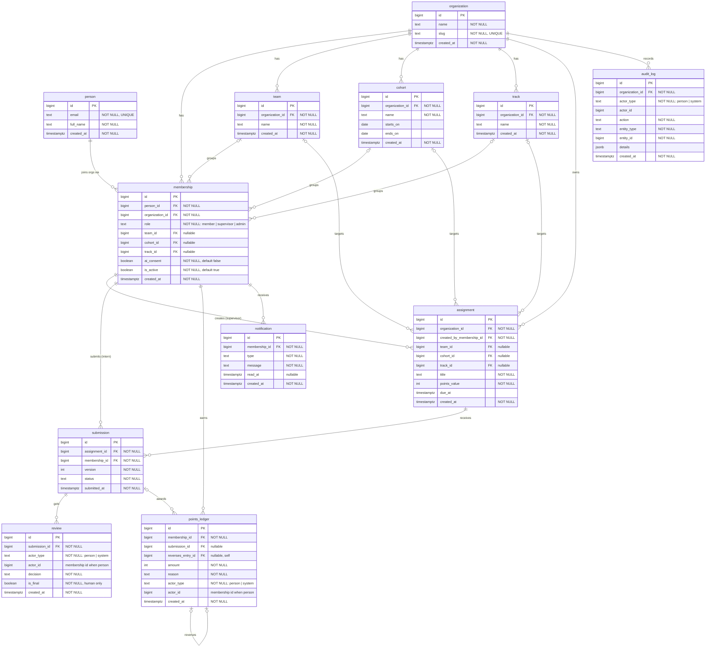

# Byline schema (SCRUM-67)

The twelve tables from SCRUM-5, their relationships, foreign keys and cardinality.
Picture: [`erd.png`](erd.png). The same diagram as Mermaid is at the bottom, so GitHub renders it too.

Database: Postgres. Models and the first Alembic migration come in SCRUM-68.

## Rules that apply to every table

- Every table has `id` as a `bigint` primary key.
- Every timestamp is `TIMESTAMPTZ`, stored in UTC. No naive datetimes.
- Foreign keys and `NOT NULL` are declared in the database, not left to the app.
- The schema is created by an Alembic migration, never by hand.

## Tables

| # | Table | What it holds | Key relationships |
|---|---|---|---|
| 1 | organization | The client company. | Parent of membership, team, cohort, track, assignment, audit_log |
| 2 | person | A human who can sign in. Email is unique. | One person has many memberships |
| 3 | membership | A person's place in one organization: their `role` (member, supervisor, admin), team, cohort, track and `ai_consent`. | person 1–many, organization 1–many. Unique on (person_id, organization_id) |
| 4 | team | A team inside the organization. | organization 1–many. A membership belongs to 0 or 1 team |
| 5 | cohort | A group of interns that start together. | organization 1–many. A membership belongs to 0 or 1 cohort |
| 6 | track | A path of work, e.g. marketing or engineering. | organization 1–many. A membership belongs to 0 or 1 track |
| 7 | assignment | Work a supervisor posts. Can target a team, cohort and/or track. | organization 1–many, created by a membership |
| 8 | submission | An intern's hand-in. A resubmit is a new row with `version + 1`. | assignment 1–many, membership 1–many. Unique on (assignment_id, membership_id, version) |
| 9 | review | A decision on a submission (approved or changes requested) with feedback. | submission 1–many. Actor is a person or the system (see below) |
| 10 | points_ledger | Points earned. Append-only. | membership 1–many, submission 0..1–many, reverses another ledger row 0..1 |
| 11 | notification | An alert for one membership. | membership 1–many |
| 12 | audit_log | Who did what, when, to which record. | organization 1–many. Actor is a person or the system |

## Decisions baked in

**Actor can be a person or the system** (for the CSC 191 AI assistant, SCRUM-52).
`review`, `points_ledger` and `audit_log` use `actor_type` (`person` or `system`) plus `actor_id`, not a hard FK to person.
When `actor_type = person`, `actor_id` is a membership id. When it is `system`, `actor_id` is null.
The assistant can only write draft reviews (`is_final = false`). Only a person can write a final review.

**AI consent.** `membership.ai_consent` is `NOT NULL DEFAULT false`. SCRUM-52 checks it before sending anything to the model.

**Points ledger is append-only.** Rows are never updated or deleted. A correction writes a new reversing row
(negative `amount`, `reverses_entry_id` pointing at the original). A member's total is `SUM(amount)`.
SCRUM-69 enforces this and tests it.

**Roles live on membership, not person**, so one person could be a member in one organization and a supervisor in another.

## Still open

- Column details on assignment, submission and review wait for Lyric's weekly tracking-sheet headers. They do not change the relationships above.
- Can a membership be in more than one team, cohort or track? This draft says no (one of each). If yes, we add join tables.

## Diagram source

