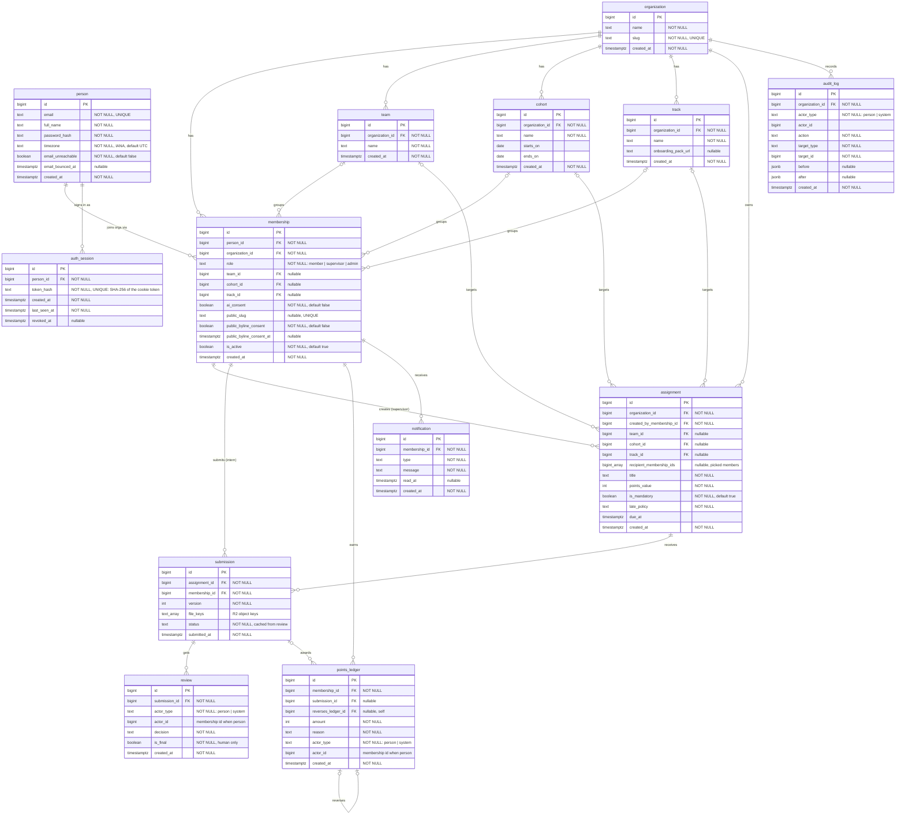

# Byline ERD (SCRUM-67)

The twelve tables from SCRUM-5, plus `auth_session` from SCRUM-13, with their relationships, foreign keys and cardinality.
The diagram is at the bottom (Mermaid, so GitHub draws it).

Database: Postgres. Models and the first Alembic migration come in SCRUM-68.

## Rules for every table

- `id` is a `bigint` primary key.
- Every timestamp is `TIMESTAMPTZ`, stored in UTC. No naive datetimes.
- Foreign keys and `NOT NULL` are declared in the database, not left to the app.
- The schema is created by an Alembic migration, never by hand.

## The tables

| # | Table | What it holds | Relationships |
|---|---|---|---|
| 1 | organization | The client company. | Parent of membership, team, cohort, track, assignment, audit_log |
| 2 | person | Someone who can sign in: email, `password_hash`, `timezone`, email bounce flag. | Has many memberships |
| 3 | membership | A person's place in one organization: `role`, team, cohort, track, `ai_consent`, public byline consent. | person 1–many, organization 1–many. Unique on (person_id, organization_id) |
| 4 | team | What a supervisor runs. | organization 1–many. A membership is on 0 or 1 team |
| 5 | cohort | The intake group an intern sits in. | organization 1–many. A membership is in 0 or 1 cohort |
| 6 | track | One of the five tracks (web dev, UX/UI, digital marketing, social media, sales), with its onboarding pack. | organization 1–many. A membership is on 0 or 1 track |
| 7 | assignment | Work a supervisor posts. Targets a team, cohort, track and/or picked members. | organization 1–many, created by a membership |
| 8 | submission | An intern's hand-in. A resubmit is a new row with `version + 1`. | assignment 1–many, membership 1–many. Unique on (assignment_id, membership_id, version) |
| 9 | review | Approve or request changes, with feedback. Can be an AI draft or a human final. | submission 1–many |
| 10 | points_ledger | Points earned. Append-only. | membership 1–many, submission 0..1–many, reverses another ledger row 0..1 |
| 11 | notification | An alert for one membership. | membership 1–many |
| 12 | audit_log | Who did what to which record, with before and after. | organization 1–many |
| 13 | auth_session | A signed-in browser (SCRUM-13): `token_hash` (SHA-256, never the token), `last_seen_at`, `revoked_at`. | person 1–many. Unique on token_hash |

## Decisions

**Sign-in** is our own passwords (`person.password_hash`), matching P01–P03.

**Actor can be a person or the system** (for the CSC 191 AI assistant, SCRUM-52).
`review`, `points_ledger` and `audit_log` use `actor_type` (`person` or `system`) plus `actor_id`, not a hard FK.
When `actor_type = person`, `actor_id` is a membership id. When it is `system`, it is null.
The assistant only writes draft reviews (`is_final = false`). Only a person writes a final one.

**AI consent.** `membership.ai_consent` is `NOT NULL DEFAULT false`. SCRUM-52 checks it before sending anything to the model.

**Public byline consent.** `public_byline_consent` (default false) and `public_byline_consent_at` record consent explicitly.
Revoking sets it back to false. `public_slug` alone no longer implies consent.

**Points ledger is append-only.** Rows are never updated or deleted. A correction writes a new row with a negative
`amount` and `reverses_ledger_id` pointing at the row it reverses (SCRUM-69). A member's total is `SUM(amount)`.

**Teams vs cohorts.** Supervisors run teams, interns sit in cohorts. A supervisor's review queue (P19) is
submissions from memberships on the team they run. Any supervisor on that team can review.

**Timezone.** `person.timezone` (IANA name, e.g. `America/Los_Angeles`) drives every due date a member sees (P18, SCRUM-15).
Due dates are still stored in UTC.

**Assignment targeting.** An assignment can target a team, cohort, track, or picked members.
Picked members are a `recipient_membership_ids` array for now, per review. Postgres can't enforce FKs inside an array,
so if this grows it becomes a join table.

**Files** live in Cloudflare R2. `submission.file_keys` holds the object keys.

**Late work.** `assignment.is_mandatory` and `assignment.late_policy` (P12). Allowed values are settled with the sheet headers.

**`submission.status` is a deliberate cache** of the latest final review's decision, so list pages don't need a join.
`review` is the source of truth. The app updates both in the same transaction.

**Audit log** (P34) records actor, target, `before`, `after` and the timestamp.

**Roles live on membership, not person**, so one person could be a member in one organization and a supervisor in another.

## Still open

- Column details on assignment, submission and review wait for Lyric's tracking-sheet headers. They don't change the table shape.
- Can one supervisor run more than one team? This draft says one team per membership. If several, we add a join table.

## Diagram

